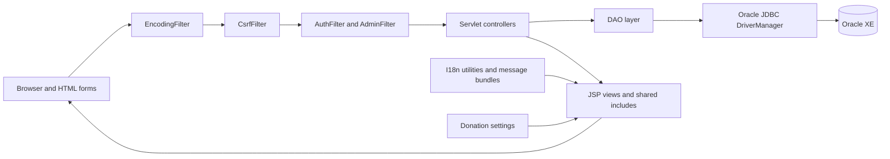
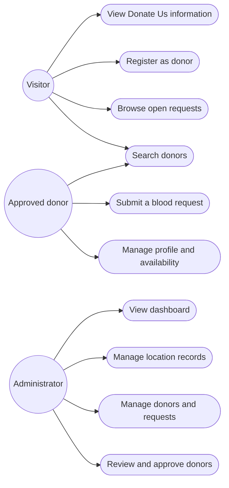
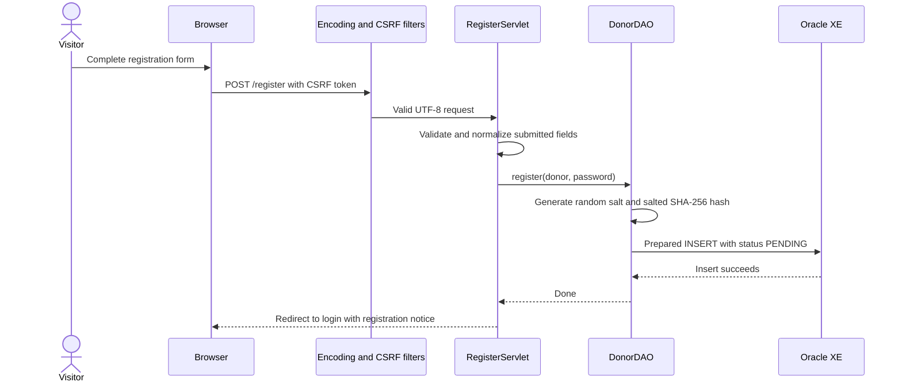
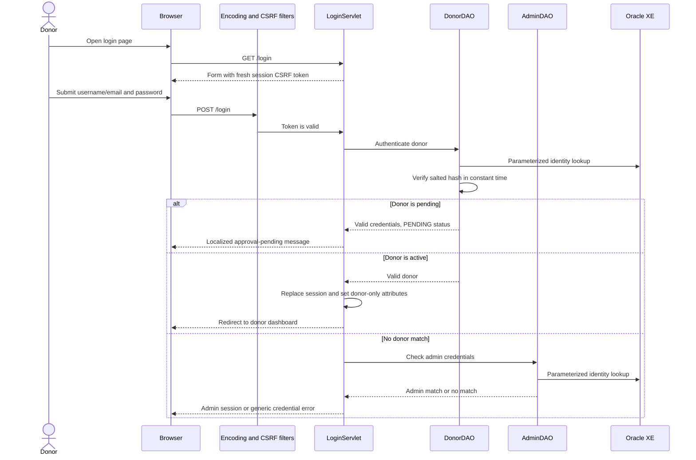
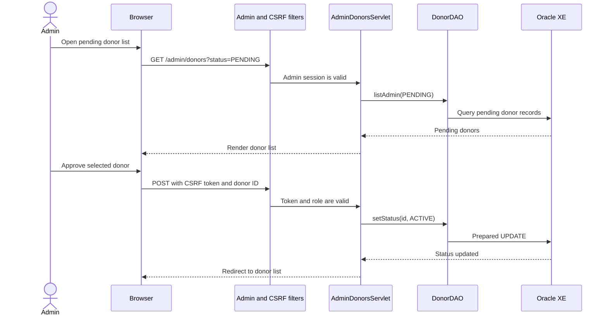
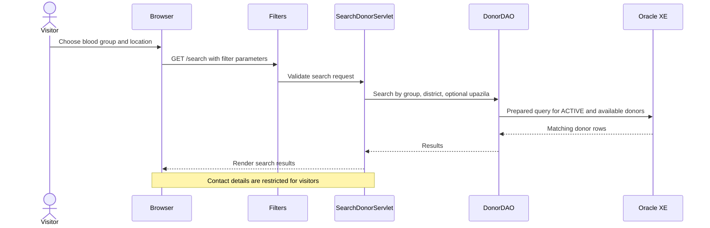
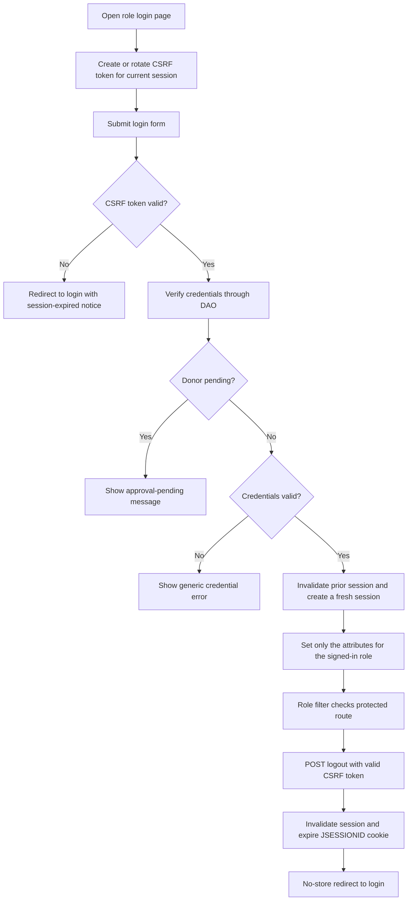
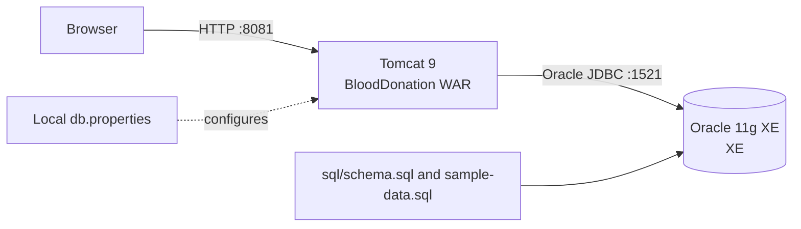
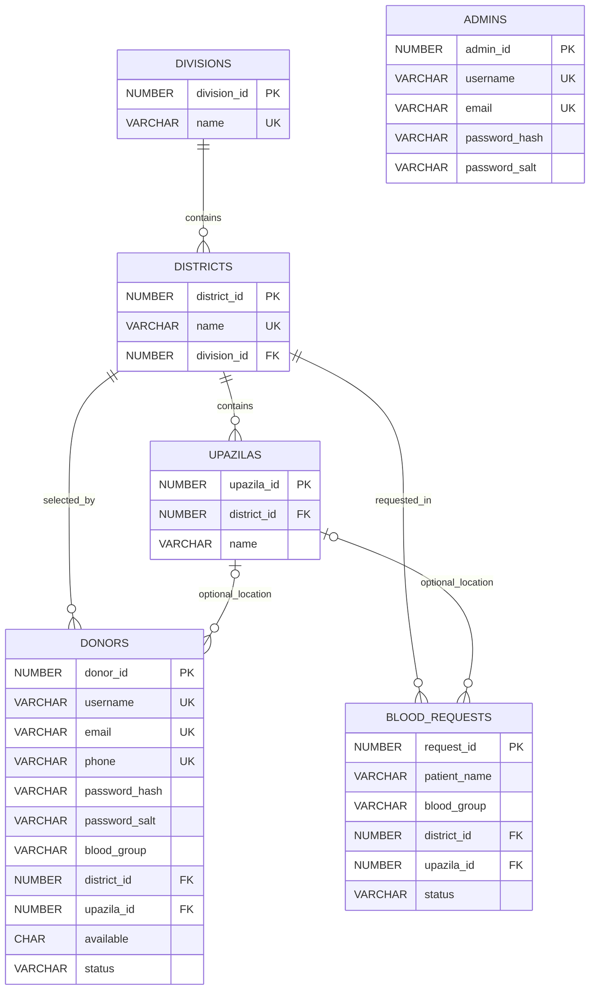

# BloodLink

BloodLink is a bilingual blood-donor and blood-request directory for Bangladesh. It helps people find available donors by blood group and location, including district and upazila, and lets donors and administrators manage profiles and urgent requests. It is intended to make it easier for a family to identify and contact a potential donor when time matters; it does not replace medical advice or a hospital blood bank.

> **Project facts:** This guide describes the checked-in Servlets/JSP application and SQL scripts. A few unused Java placeholders are noted as TODOs rather than described as working features.

## What the application does

### Visitor

- View the home page and open blood requests.
- Search active, available donors by blood group, district, and optional upazila.
- Browse About, Contact, and Donate Us pages.
- Register a donor profile. A new profile starts as `PENDING`.
- Donor contact details are not shown to an unauthenticated visitor.

### Donor

- Sign in after an administrator approves the profile.
- View and update profile details, location, blood group, availability, and last donation date.
- Browse donor and request information and submit blood requests.

### Administrator

- View donor, request, and location summaries.
- Review donor records and change status, including approving pending accounts.
- Manage donor and blood-request records.
- Manage divisions, districts, and upazilas.

### Shared pages

- The header language switch selects Bangla or English and persists the selection across navigation.
- The Donate Us page provides informational bKash, Nagad, Rocket, and bank-transfer cards, amount suggestions, and copy instructions. It does **not** process payments or record a transaction.
- Payment and contact details are placeholders in [`donation.properties`](src/main/resources/i18n/donation.properties). Replace them with verified owner-approved details before deployment.

## Technology

| Area | Actual project configuration |
|---|---|
| Java | JDK 22; Maven compiler release 22 |
| Web application | Java Servlets (`javax.servlet-api` 4.0.1), JSP, JSTL 1.2 |
| Build/package | Maven WAR; the project does not pin a Maven version |
| Servlet container | Tomcat 9; [`run.bat`](run.bat) is set up for Tomcat 9.0.123 |
| Database | Oracle Database 11g XE |
| JDBC | Oracle `ojdbc6` 11.2.0.4 |
| Front end | HTML, CSS, vanilla JavaScript, and JSTL; no large JavaScript framework |
| Fonts | Google Fonts `Hind Siliguri` and `Inter`, with local fallbacks |

Tomcat 10 uses the `jakarta.servlet` namespace and is not compatible with this code as-is. The Google Fonts link requires network access; the CSS includes fallback fonts.

## Architecture

JSPs render the views, Servlets handle HTTP requests, DAOs contain database queries, and Oracle stores application data. The filters are registered in [`web.xml`](src/main/webapp/WEB-INF/web.xml); servlet routes are also declared with `@WebServlet`.

### System architecture diagram



The diagram shows the request path from browser through the filters and controllers to the DAO and database layers, followed by JSP rendering. The locale bundles and donation configuration provide view text and placeholder details without changing the database schema.

**What to say in the presentation:** “The browser talks to Servlet controllers. Filters handle cross-cutting request concerns, DAOs isolate SQL, and JSPs render the response.”

### Source and important files

```text
sql/
  schema.sql                       Oracle tables, constraints, sequences, triggers, indexes
  sample-data.sql                  Starter location and application records
src/main/java/com/blood/
  dao/                             AdminDAO, DonorDAO, LocationDAO, RequestDAO
  filter/                          Encoding, CSRF, donor-auth, and admin-auth filters
  model/                           Admin, Donor, BloodRequest, Division, District, Upazila
  servlet/                         Public, donor, and shared request controllers
  servlet/admin/                   Admin dashboard and management controllers
  util/                            DBConnection, I18n, PasswordUtil, Validator, WebUtil, CsrfUtil
src/main/resources/
  db.properties                    Oracle JDBC settings (keep the real password local)
  i18n/messages_en.properties      English UI and validation messages
  i18n/messages_bn.properties      Bangla UI and validation messages
  i18n/donation.properties         Payment and contact placeholders
src/main/webapp/
  WEB-INF/web.xml                  Welcome page and filter configuration
  WEB-INF/jspf/lang.jspf           Shared locale and message-bundle setup
  includes/                        Public header, navbar, and footer
  admin/includes/                  Admin header and footer
  user/                            Donor dashboard, profile, and profile editor
  admin/                           Admin dashboard and management views
  assets/css/                      Site, responsive, admin, and searchable-select styles
  assets/js/                       Navigation and searchable-select behavior
  *.jsp                            Home, login, registration, search, requests, donate, and static pages
run.bat                            Windows build and Tomcat deployment helper
pom.xml                            Maven WAR configuration and dependency versions
```

`DonateServlet.java`, `LanguageFilter.java`, and `DBPoolLifecycleListener.java` are empty/unmapped placeholders in the current source; they are not used to serve the Donate page, select a locale, or manage a connection pool. **TODO: confirm whether these placeholders should be removed or implemented.** The active Donate page is `donate.jsp`; locale selection is handled by the existing I18n/JSP path; database connections use `DriverManager`.

### Main routes

| Route | Purpose |
|---|---|
| `/` and `/index` | Home page |
| `/search` | Donor search |
| `/requests` and `/request` | Browse requests and submit a request |
| `/register`, `/login`, `/logout` | Donor registration and authentication |
| `/user/dashboard`, `/user/profile`, `/user/edit-profile` | Donor area |
| `/admin/login`, `/admin/logout` | Admin authentication |
| `/admin/dashboard`, `/admin/donors`, `/admin/requests`, `/admin/locations` | Admin workspaces |
| `/upazilas` | Location lookup used by forms |
| `/donate.jsp` | Informational Donate Us page |

## User stories and diagrams

### Use cases



Visitors can explore public information and register, while donor-only actions require an approved donor session. Administrators have separate routes for approvals and record management.

**What to say in the presentation:** “The roles reflect how the service is used: visitors find information, approved donors maintain profiles, and administrators keep records and approvals current.”

### Donor registration sequence



Registration creates a `PENDING` donor row and does not create an authenticated donor session. The account must be approved before the donor can sign in.

**What to say in the presentation:** “Registration stores a salted password hash, not the password. The new record is pending until an administrator reviews it.”

### Donor login sequence



The login flow checks credentials through DAOs and distinguishes a valid-but-pending donor from an invalid credential pair. Successful authentication replaces the prior session and sets attributes for the authenticated role.

**What to say in the presentation:** “The login form is protected by a session CSRF token. A pending donor gets an approval message; an active donor or administrator receives a role-specific session.”

### Administrator approval sequence



Approval updates the existing donor row; it does not require a new table or column. Once active, the donor can sign in and may qualify for donor search based on availability and last-donation date.

**What to say in the presentation:** “The administrator reviews a pending record and changes its status to active. That status controls both donor login and public search eligibility.”

### Donor search sequence



Search filters are parameterized. The DAO includes active/available status and a three-month last-donation eligibility condition; a visitor does not receive donor contact details.

**What to say in the presentation:** “The location filters help narrow the result to a useful area, and the query excludes inactive or unavailable donors.”

### Authentication and session flow



Login pages rotate their CSRF token, and successful logins use a new session. Logout invalidates the session, expires the context-scoped `JSESSIONID` cookie, and redirects with no-store headers.

**What to say in the presentation:** “The session belongs to one role, and logout removes both the server session and its browser cookie. CSRF-protected forms prevent a stale login form from silently appearing to succeed.”

### Deployment



The browser reaches the WAR under the `/BloodDonation` context on the configured Tomcat HTTP port. Tomcat opens JDBC connections to Oracle XE; the two SQL scripts are run separately before the application is used.

**What to say in the presentation:** “The application is deployed as a WAR on Tomcat. Oracle listens separately on port 1521, while the browser uses the Tomcat HTTP connector on port 8081.”

## Database

The authoritative schema is [`sql/schema.sql`](sql/schema.sql); the optional starter records are in [`sql/sample-data.sql`](sql/sample-data.sql). The application does not create or alter the schema at runtime.

| Table | Purpose and important columns |
|---|---|
| `divisions` | Bangladesh divisions; `division_id` primary key and unique `name`. |
| `districts` | District lookup; `district_id` primary key, `name`, and required `division_id` foreign key. |
| `upazilas` | Upazila/thana lookup; `upazila_id` primary key, required `district_id`, and unique location/name constraints. |
| `donors` | Donor profile and authentication; `donor_id`, unique `username`, `email`, and `phone`, `password_hash`, `password_salt`, `blood_group`, required `district_id`, optional `upazila_id`, `last_donation`, `available`, `status`, and timestamps. A composite foreign key keeps an optional upazila in the selected district. |
| `blood_requests` | Patient/request details; `request_id`, `patient_name`, `blood_group`, `hospital`, `district_id`, optional `upazila_id`, `contact_phone`, `needed_date`, `details`, `status`, and `created_at`. |
| `admins` | Administrator login; `admin_id`, unique `username` and `email`, `password_hash`, `password_salt`, and `created_at`. |

Sequences and triggers generate IDs. The schema also defines blood-group and status checks, foreign keys, uniqueness constraints, and search indexes.

### Entity relationship diagram



The diagram follows the foreign keys in the checked-in schema. An upazila is optional for donors and requests, but when supplied its district must match the record's district; admins are not linked to these location tables.

**What to say in the presentation:** “The location tables form a division-to-district-to-upazila hierarchy. Donors and requests always have a district and may also point to an upazila in that same district.”

### Status and approval rules

- Donor status is constrained to `PENDING`, `ACTIVE`, or `BLOCKED`. Self-registration starts at `PENDING`; administrators can approve by changing it to `ACTIVE`.
- A pending donor cannot complete donor sign-in until approval. A blocked donor is not eligible for public search.
- Public donor search requires `ACTIVE`, `available = 'Y'`, and no donation within the previous three months (or no recorded last-donation date).
- `available` is constrained to `Y` or `N`.
- Blood-request status is constrained to `OPEN`, `FULFILLED`, or `CLOSED`.

## Security and data handling

- **Password storage:** `PasswordUtil` generates a random 24-byte salt, stores it as hex, and computes SHA-256 over the UTF-8 bytes of `salt + password`. Verification uses `MessageDigest.isEqual`. This is the current implementation, not a modern password-hardening KDF; migrating to PBKDF2/Argon2 is a future improvement that must preserve existing-account access.
- **SQL injection defense:** DAOs use `PreparedStatement` for submitted values.
- **Resource lifecycle:** DAOs open connections through `DBConnection` and close connections, statements, and result sets with try-with-resources. There is no connection pool in the current application.
- **CSRF:** POST requests are checked by `CsrfFilter` against a random session token; the token comparison is constant-time.
- **Sessions and roles:** successful login replaces the prior session and sets role-specific attributes. `AuthFilter` protects donor routes and `AdminFilter` protects admin routes. Logout invalidates the session and expires `JSESSIONID`.
- **Caching:** login and logout responses use no-store/no-cache headers so stale forms/pages are less likely to be reused.
- **Input and output:** `Validator` checks/normalizes form values; JSP output uses JSTL escaping such as `c:out`.
- **Encoding and locale:** request/response encoding is UTF-8. UI messages come from the English and Bangla resource bundles; user-entered names and database values are not translated.
- **Credentials:** `db.properties` is packaged in the WAR. Keep deployment credentials out of source control and protect the built WAR and deployed configuration.

## Setup and run

### Prerequisites

- JDK 22 and Maven installed and available on `PATH`.
- Tomcat 9 configured to run with a compatible JDK.
- Oracle Database 11g XE and its listener on port 1521.
- SQL*Plus, SQL Developer, or an equivalent Oracle SQL client.

### Create the database user and load the schema

Connect to XE as an Oracle administrator and create the application user if it does not already exist. Substitute a strong local password; do not put a real password in this README or commit it.

```sql
CREATE USER blooddb IDENTIFIED BY "REPLACE_WITH_LOCAL_PASSWORD"
  DEFAULT TABLESPACE users TEMPORARY TABLESPACE temp;
GRANT CREATE SESSION, CREATE TABLE, CREATE SEQUENCE, CREATE TRIGGER TO blooddb;
ALTER USER blooddb QUOTA UNLIMITED ON users;
```

Then connect as `blooddb`, run the schema script once, and load the optional sample data:

```text
sqlplus /nolog
SQL> CONNECT blooddb@localhost:1521/XE
Enter password: (enter the local database password at the prompt)
SQL> @sql/schema.sql
SQL> @sql/sample-data.sql
```

Run the scripts from the repository root or provide their absolute paths. Run `schema.sql` before `sample-data.sql`; sample inserts are intended for an empty schema and should not be repeated against an already populated database.

### Configure the JDBC connection

Set the local values in `src/main/resources/db.properties` before packaging:

```properties
jdbc.driver=oracle.jdbc.OracleDriver
jdbc.url=jdbc:oracle:thin:@localhost:1521:XE
jdbc.username=blooddb
jdbc.password=REPLACE_WITH_LOCAL_PASSWORD
```

The checked-in JDBC URL uses the Oracle thin SID form with `XE`. If the local Oracle listener requires service-name syntax, use the equivalent `jdbc:oracle:thin:@//localhost:1521/XE`. Never commit a real database password. **TODO: confirm the team's preferred external-secret configuration for deployed environments.**

The initial admin record is inserted by the sample-data script. Its local demonstration credential is intentionally not repeated in this documentation; obtain it through the project owner or configure a local test account securely. **TODO: confirm the preferred admin bootstrap and credential handoff process.**

### Build

From the project root:

```powershell
mvn clean package
```

The WAR is `target/BloodDonation.war`. Maven currently reports that there are no automated test sources; use the manual checks below after deployment.

### Deploy to Tomcat

Set Tomcat's HTTP connector to port `8081` if it is not already configured that way. [`run.bat`](run.bat) is the repository's Windows deployment helper: it expects JDK 22 at `C:\Program Files\Java\jdk-22` and Tomcat 9.0.123 at `C:\tools\apache-tomcat-9.0.123`; it stops Tomcat, cleans the generated `target` output, packages the WAR, copies it to `webapps`, and starts Tomcat.

Run `run.bat` from the repository root, or deploy manually:

```powershell
$env:JAVA_HOME = 'C:\Program Files\Java\jdk-22'
$TomcatHome = 'C:\tools\apache-tomcat-9.0.123'
& "$TomcatHome\bin\shutdown.bat"
mvn clean package
Copy-Item '.\target\BloodDonation.war' "$TomcatHome\webapps\BloodDonation.war" -Force
& "$TomcatHome\bin\startup.bat"
```

Open [http://localhost:8081/BloodDonation/](http://localhost:8081/BloodDonation/). If the application does not deploy, inspect `logs/localhost.*.log` and `logs/catalina.*.log` under the Tomcat base directory.

**OneDrive build tip:** this repository is under OneDrive. If `mvn clean package` cannot delete a generated `target` directory, stop Tomcat and retry. If OneDrive still holds generated output, remove only the project's generated `target` folder and rerun the build; do not delete or move the project.

## Troubleshooting

| Symptom | Checks and response |
|---|---|
| Login says the account is pending | Ask an administrator to review and activate the donor. Pending accounts are not allowed into the donor area. |
| Generic login failure | Check the username/email and password, confirm the account is active, and verify Oracle is reachable. The generic response intentionally does not confirm whether an identity exists. |
| “Session expired” on login | Reload the login page to get a new CSRF token, then submit again. Confirm the browser is not reusing an old page. |
| `ORA-28000` | The Oracle account is locked. As an Oracle administrator, run `ALTER USER blooddb ACCOUNT UNLOCK;`, then confirm the account password in local `db.properties`. |
| `ORA-01017` | The configured Oracle username/password was rejected. Check local `db.properties` and the database user; do not paste credentials into logs or tickets. |
| `ORA-12519` or listener refuses connections | Check that the XE service is available and the listener has capacity to accept sessions. Retry after the database service recovers; inspect Oracle listener/database logs as well as Tomcat logs. |
| `ORA-12541` / `ORA-12514` | Confirm the Oracle listener is running on port 1521 and that the URL uses the XE SID/service configured on this machine. |
| Bangla text appears as `????` or mojibake | Confirm the browser page and JSPs use UTF-8, the request encoding filter is active, and `messages_bn.properties` is saved as UTF-8. Check that the browser has selected Bangla. Google Fonts needs network access; the CSS fallback should still render Bengali-capable system fonts. |
| App opens at the wrong port or returns 404 | The expected URL is `/BloodDonation/` on Tomcat port 8081. Confirm the HTTP connector, deployed WAR name, context path, and Tomcat logs. Port 8080 is a common default and is not the documented app port here. |
| Maven cannot clean `target` on Windows | Stop Tomcat fully and retry. If OneDrive still locks generated output, remove only `target` and rebuild. |

## Manual verification checklist

- [ ] Visit `/BloodDonation/`; check public navigation, search, requests, and Donate Us.
- [ ] Switch English/Bangla, navigate to another page, refresh, and confirm the language persists.
- [ ] Register a donor, confirm its initial `PENDING` status, approve it as an admin, then sign in as that donor.
- [ ] Repeat donor login → logout → admin login → logout → donor login twice.
- [ ] Keep admin and donor sessions open in separate browser profiles; confirm each can access only its own protected routes.
- [ ] Search donors by blood group, district, and upazila; confirm pending, blocked, unavailable, and recently donated profiles are excluded.
- [ ] Try a stale login CSRF token and confirm the bilingual session-expired message is shown.
- [ ] Check the Donate Us layout on mobile and desktop widths; confirm all payment/contact values remain placeholders until replaced by the owner.
- [ ] Review Tomcat logs and the browser console after the checks.

## Future improvements

- Migrate password storage to a modern, slow password KDF while retaining a safe upgrade path for existing accounts.
- Add focused automated tests for login/session transitions, CSRF expiration, approval status, and search filters.
- Add rate limiting and account recovery/email verification.
- Move database credentials to an external secret store or container/service configuration.
- Consider a managed connection pool after setting an appropriate Oracle XE session limit.
- Confirm and clean up the unused placeholder Java classes.
- Add owner-verified payment details and a documented donation reconciliation process; do not claim payments are tracked by the current application.

## Presentation guide

### Suggested 11-slide outline

1. **BloodLink:** project purpose and team/course details.
2. **The problem:** finding an available blood donor quickly in Bangladesh.
3. **Who uses it:** Visitor, Donor, and Administrator roles.
4. **Public experience:** blood-group, district, and upazila search; open requests.
5. **Architecture:** JSP, Servlet, filters, DAO, JDBC, Oracle.
6. **Database model:** location hierarchy, donors, requests, and admins.
7. **Registration and security:** validation, salted hash, CSRF, and pending status.
8. **Admin workflow:** approve donors and manage records.
9. **Donor workflow:** profile, availability, and blood-request features.
10. **Bilingual and Donate Us pages:** language persistence and clearly marked placeholders.
11. **Live demo and next steps:** show the workflow, limitations, and future improvements.

### Five-minute demo script

Use a local test database and credentials that are not shown on screen or included in presentation materials.

| Time | Demo |
|---|---|
| 0:00–0:35 | Open the home page, switch to Bangla and back to English, and point out the donor search. |
| 0:35–1:20 | Search by blood group and district; optionally select an upazila and show the result list. |
| 1:20–2:10 | Register a test donor in a separate/private browser profile and explain why it starts as `PENDING`. |
| 2:10–3:05 | Sign in as an administrator in another browser profile and approve the pending donor. |
| 3:05–4:05 | Sign in as the approved donor, show the dashboard/profile, and repeat a donor search. |
| 4:05–4:40 | Open Donate Us and explain the placeholder payment information and the manual payment instructions. |
| 4:40–5:00 | Close with the three roles, privacy/security protections, and future improvements. |

### Likely teacher questions

1. **What problem does BloodLink address?**
   It helps people locate potential blood donors by blood group and Bangladesh location, and provides a place to browse blood requests.

2. **Why are new donors pending?**
   The application requires an administrator to review a self-registered profile before it becomes an active donor account.

3. **How is a donor selected for public search?**
   The search DAO requires an active, available donor and applies a three-month last-donation eligibility condition.

4. **How do you reduce SQL injection risk?**
   Submitted values are bound through `PreparedStatement` parameters rather than inserted into SQL as user-controlled text.

5. **How are passwords stored?**
   The current code stores a random salt and a SHA-256 hash of the salt plus password; it never stores the submitted password as the database value.

6. **How are admin and donor routes separated?**
   Separate session attributes are set after login, and `AdminFilter`/`AuthFilter` check access to their protected URL patterns.

7. **How does the language switch work?**
   English and Bangla message keys live in separate resource bundles; the selected locale is persisted and reused while navigating.

8. **What is the role of the DAO layer?**
   DAOs contain database operations so Servlets can handle request flow without embedding SQL in JSP views.

9. **Does Donate Us process payments?**
   No. It displays instructions and owner-replaceable placeholder details; payments are completed outside the application.

10. **What would you improve next?**
    Use a modern password KDF, add automated tests and rate limiting, move credentials out of the WAR, and add an owner-approved donation reconciliation workflow.
